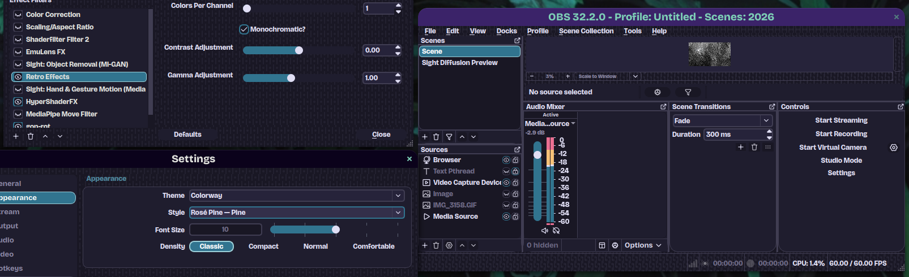

# Colorway

Colorway is a browser-based workbench for authoring, previewing, and installing OBS Studio
color themes. The product is the theme corpus: 166 curated `.ovt` variants layered on one
standalone base theme (`themes/Colorway.obt`), with their generated `public/` mirrors and
documented palette provenance kept provably consistent.

The site is a Vite single-page app with no backend. It previews every variant in a simulated
OBS Appearance workflow, downloads single themes or complete ZIP packages, converts an uploaded
`.ovt` into the Colorway format, and generates a theme from any Lospec palette.



## Quick start

```bash
pnpm install --frozen-lockfile   # pnpm 11.17.0 is pinned via packageManager
pnpm dev                         # Vite dev server on 0.0.0.0
pnpm test                        # Node test suite (test/**/*.test.js)
pnpm build                       # production build to dist/
```

Use `pnpm`, not `npm`: the lockfile is pnpm's and CI installs with pnpm. There is no lint
script and no server-side component.

## Repository layout

| Path | Contents |
|---|---|
| `themes/` | Source of truth: `Colorway.obt` plus 166 `Colorway-*.ovt` variants |
| `public/` | Generated mirror of themes, patterns, icons, fonts, and package docs |
| `src/` | Vite app: theme engine, workbench, and the OBS preview layer |
| `scripts/` | Theme sync, generators, and browser/native verification checks |
| `test/` | Node contracts, including optional offscreen Qt checks |
| `obs-companion/` | Optional OBS Lua pattern picker and offline preview dock |
| `patterns/`, `icons/`, `fonts/` | Bundled pattern SVGs, MingCute icon set, Bricolage Grotesque |
| `docs/` | Architecture, install, compatibility, and provenance detail |
| `data/` | Palette provenance and source-palette checkpoints |

`index.html` must stay at the repository root because Vite serves from there. `src/` is
intentionally flat; see `.meristem/PROJECT.md` for the boundaries between modules.

## Themes and the sync contract

`themes/` is authoritative and `public/themes/` is a byte-identical mirror. Edit a theme, then
run `pnpm sync:themes`; until you do, the two copies drift and the contract test fails. The
sync script also regenerates the state-token blocks marked
`/* colorway:state-tokens:start ... end */`, mirrors patterns, icons, and fonts, and writes
`public/theme-assets.json`, `public/INSTALL.md`, and `public/THEME_CREDITS.md`.

```bash
pnpm sync:themes        # regenerate the public/ mirror from themes/
pnpm generate:siblings  # regenerate the eight Catppuccin-inspired sibling palettes, then sync
```

A clean `pnpm sync:themes` on a pristine tree must leave `git status` empty. Regeneration is
expected to be a no-op, not a formatting pass. Generated sibling output is contract-tested
against `scripts/generate-catppuccin-siblings.mjs`; a green `pnpm test` is the proof that the
checked-in artifacts still match their generator.

Hand-written additions are the exception: new curated variants are added to `themes/` and
registered by hand in `THEMES` in `src/theme-catalog.js`. Nothing generates that catalog.

## Verification

```bash
pnpm test              # Node suite; Qt checks run when PyQt6 is available
pnpm build             # Vite production build
pnpm check:preview     # build, then compare browser paint to QSS-derived roles in Chromium
pnpm check:preview-qt  # compare visible combo/text-input states and generated CSS roles
pnpm check:qt-formats  # compare PNG, lossless WebP and SVG paint in Chromium
pnpm check:exports     # build, then exercise real export downloads and build-kit syntax
pnpm check:shuffle     # build, then verify slideshow pause/resume in Chromium
pnpm check:companion   # build the companion, then render the offline dock in Chromium
pnpm check:obs-native  # native OBS/Qt probe; requires obs, xvfb-run, Qt6Widgets headers
pnpm check:obs-upstream # upstream OBS theme-format drift watch
```

Read the current pass/skip summary from `pnpm test` rather than a number written in a document.
The single skipped test (`fromLospecPalette`) is network-gated by design and is not a failure.
`check:preview`, `check:exports`, `check:shuffle`, and `check:companion` need a local Chromium
(`/usr/bin/chromium`, overridable with `CHROMIUM_PATH`); `check:obs-native` needs a real OBS
install and never touches `~/.config/obs-studio`.

`check:preview` serves the built site on port 5189 and refuses to start if that port is already
serving something else. To use a different port, set `COLORWAY_PREVIEW_PORT`.

The optional Qt reference gate needs PyQt6 (`COLORWAY_QT_PYTHON` overrides
the Python executable). It compares visible browser input states with native
Qt pixels and checks generated showcase CSS roles, without launching OBS.

```bash
pnpm generate:preview-css
pnpm generate:qt-atlas --output /tmp/colorway-atlas
# Or generate lossless WebP sheets for all themes:
pnpm generate:qt-atlas --output /tmp/colorway-webp --format webp
# Individual native PNG / WebP / SVG state specimens for one theme:
pnpm generate:qt-atlas --output /tmp/colorway-specimens --theme Colorway-Monokai.ovt --specimens --format png --format webp --format svg
```

Optional image format checks need Qt SVG support, the Qt WebP plugin and
Pillow (independent lossless decoder for streams rejected by Qt).
The CSS projection is regenerated by `pnpm sync:themes` and used directly by
the interactive catalog preview. The local optional atlas generator creates
one contact sheet and an index per batch, using the actual inheritance chain.
See [native reference rendering](docs/OBS_THEME_COMPATIBILITY.md#standalone-qt-preview-reference).

## Installing a theme

See [`docs/INSTALL.md`](docs/INSTALL.md) for package layout, per-platform OBS theme
directories, the optional Bricolage Grotesque OS-font install, and the companion tools.
`bash scripts/copy-themes.sh /path/to/obs-studio/themes` copies themes, icons, and patterns
from this checkout into a chosen destination.

## Documentation

| Document | Scope |
|---|---|
| [`docs/ARCHITECTURE.md`](docs/ARCHITECTURE.md) | Architecture, OVT format, token tables, color math |
| [`docs/INSTALL.md`](docs/INSTALL.md) | Installation and export instructions |
| [`docs/OBS_THEME_COMPATIBILITY.md`](docs/OBS_THEME_COMPATIBILITY.md) | OBS version compatibility and upstream watch |
| [`docs/THEME_CREDITS.md`](docs/THEME_CREDITS.md) | Per-variant provenance and palette fidelity |
| [`docs/CATPPUCCIN_SIBLINGS_V2.md`](docs/CATPPUCCIN_SIBLINGS_V2.md) | Sibling palette recipe (contract-tested) |
| [`docs/OBS_DESIGN_REFERENCE.md`](docs/OBS_DESIGN_REFERENCE.md) | Design evidence used by the preview |
| [`UBIQUITOUS_LANGUAGE.md`](UBIQUITOUS_LANGUAGE.md) | Domain glossary |
| [`ACTIVE_WORK.md`](ACTIVE_WORK.md) | Current work state and verification checkpoints |
| [`AGENTS.md`](AGENTS.md) | Agent working rules for this repository |
| [`.meristem/PROJECT.md`](.meristem/PROJECT.md) | Durable purpose, invariants, and architecture boundaries |

`docs/COLORWAY_BASE_REVIEW.md`, `docs/NATIVE_CONTROL_AUDIT.md`, and
`docs/MINGCUTE_MIGRATION.md` are dated review records. Their figures describe the state at the
time of that review; recover current values from the repository and the test suite.

## License

Colorway is GPL-3.0; see [`LICENSE`](LICENSE). Bundled assets keep their own licenses:
Bricolage Grotesque under the SIL Open Font License (`fonts/OFL.txt`) and MingCute icons under
the Apache License 2.0 (`icons/colorway/mingcute/LICENSE`). Adapted palettes retain their
original creators' attribution in `docs/THEME_CREDITS.md`.